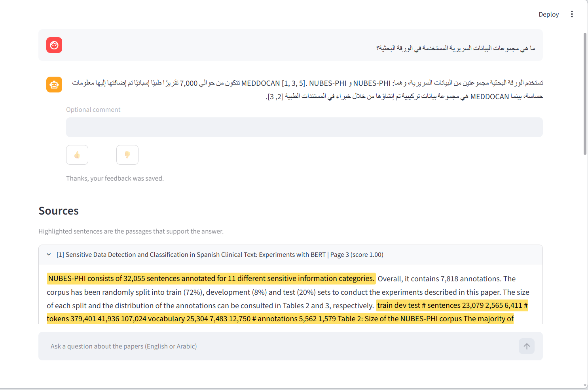
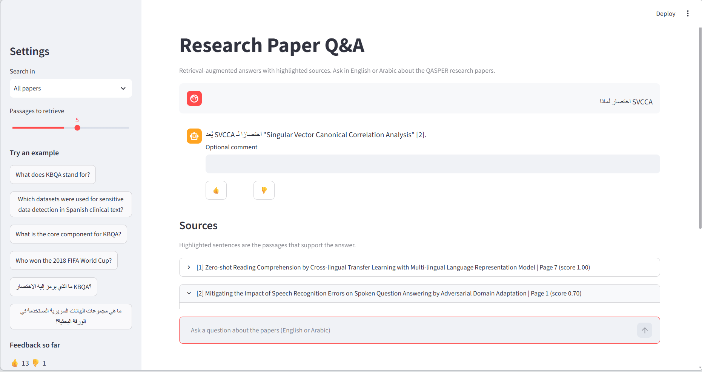
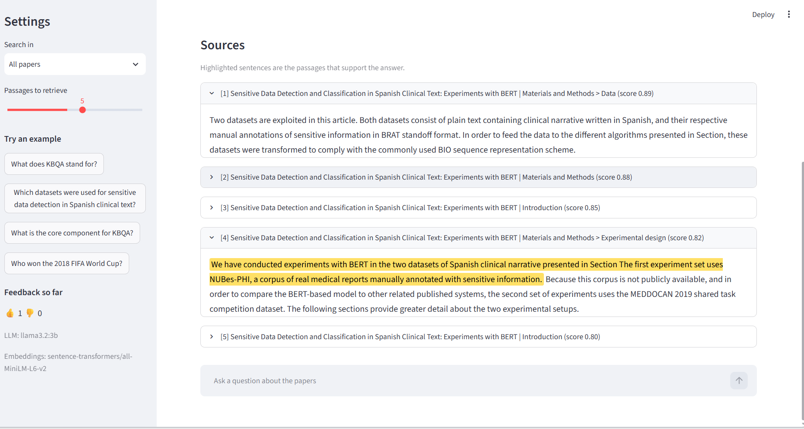
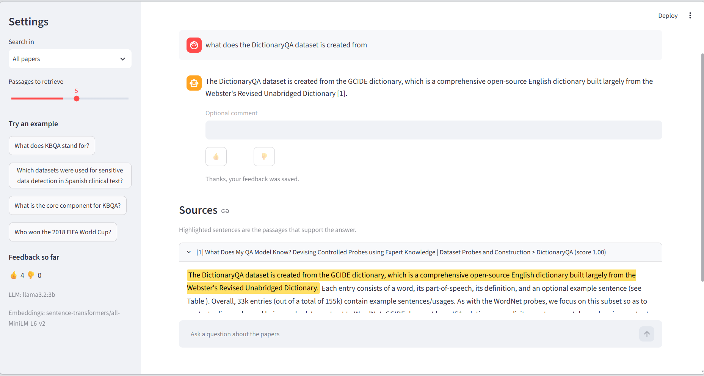
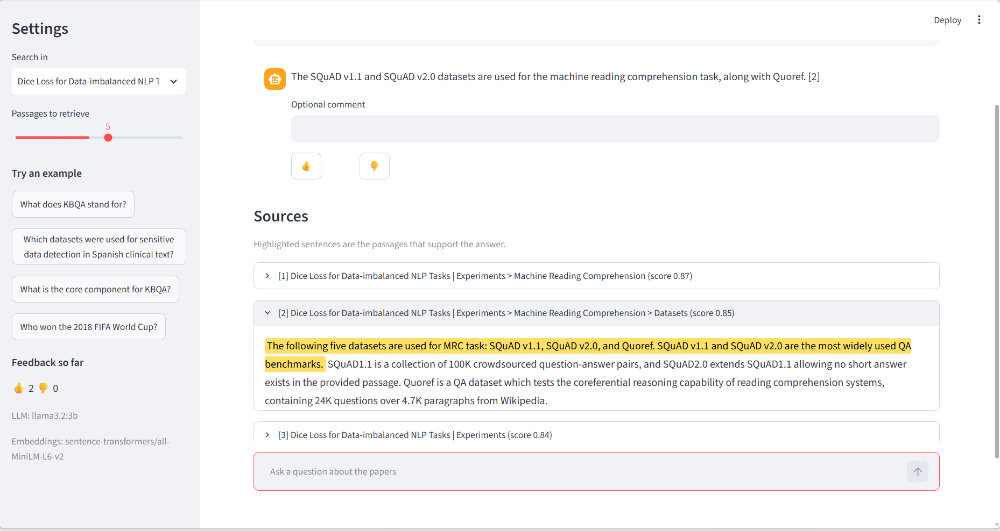

# Research Paper Q&A: a bilingual (English and Arabic) RAG system over QASPER papers

A retrieval-augmented generation (RAG) system that answers questions about NLP research papers. The papers are real PDFs. Their text is extracted (PyMuPDF for English, Tesseract OCR for Arabic documents), cleaned, chunked, embedded with a multilingual model and searched. A local language model then writes an answer **in the language of the question**, cites its sources, and the supporting sentences are highlighted in the sources. Questions can be asked in **English or Arabic**, and anything outside the papers is refused.

Everything runs locally (sentence-transformers, FAISS and Ollama). Most design choices were selected by measured comparisons. The JSON reports are in `results/`, and the full write-up is in [docs/EXPERIMENTS.md](docs/EXPERIMENTS.md).

**Author:** Yazan Ashour | **Task:** Build a Simple Retrieval-Augmented Generation (RAG) System (trainer: Ali Obaid), plus the supervisor's follow-up requirements.


## Contents

1. [Results at a glance](#results-at-a-glance)
2. [Setup and quickstart](#setup-and-quickstart)
3. [Architecture](#architecture)
4. [Final configuration](#final-configuration)
5. [Dataset and corpus](#dataset-and-corpus)
6. [Usage](#usage)
7. [Sample inputs and outputs](#sample-inputs-and-outputs)
8. [Web interface](#web-interface)
9. [Design decisions](#design-decisions)
10. [Limitations](#limitations)
11. [Task requirements](#task-requirements)
12. [Project structure](#project-structure)
13. [Troubleshooting](#troubleshooting)
14. [Acknowledgements and licenses](#acknowledgements-and-licenses)

## Results at a glance

| Area | Result |
|---|---|
| Retrieval, English questions (32 questions) | hit@5: **68.8%** paper-scoped, **46.9%** global |
| Retrieval, Arabic questions over the English papers | hit@5: **71.9%** paper-scoped, **50.0%** global |
| English PDF extraction | PyMuPDF recovers 78.8% of the reference text in 0.3 s; OCR is within one point but about 600 times slower |
| Arabic PDF extraction | OCR recovers 96.5% (digital) and 97.1% (scan) of the words, against 88.1% for text layers |
| Arabic retrieval on the generated Arabic PDFs | hit@5: 91.7% (digital, OCR) and 95.8% (scan, OCR), against 72.9% with the PyMuPDF text layer |
| Language models | English: `llama3.2:3b`. Arabic: `gemma3:4b` |
| Chunk overlap | Tested at 25, 50 and 75 words; no benefit, so it is not used |
| Reranker (`bge-reranker-v2-m3`) | Sharper top-1 (English global hit@1: 2 to 6 of 32) but no hit@5 gain (scoped 22 to 20, global 15 to 14) and 8 to 9 s per question on a CPU, so it is not used |

Hit rates come from 32 evaluation questions, so one question is worth about 3 points. See [Limitations](#limitations).

## Setup and quickstart

**Prerequisites:** Python 3.10 to 3.12 and [Ollama](https://ollama.com). Tesseract OCR with Arabic language data is needed only for the Arabic document experiments, not for the app or the English index. Generating the Arabic PDFs also needs an Arabic-capable font (Arial on Windows is detected automatically).

```bash
git clone https://github.com/Yazan-Ashour/research-paper-rag-qa.git
cd research-paper-rag-qa

python -m venv .venv
# Windows PowerShell: .venv\Scripts\Activate.ps1
# macOS / Linux:      source .venv/bin/activate

python -m pip install --upgrade pip
pip install -r requirements.txt

ollama pull llama3.2:3b
ollama pull gemma3:4b
```

**Configuration.** Copy `.env.example` to `.env`:

```text
LLM_API_KEY=ollama
LLM_BASE_URL=http://localhost:11434/v1
LLM_MODEL=llama3.2:3b
LLM_MODEL_AR=gemma3:4b
# Optional reranker, off while empty (see docs/EXPERIMENTS.md, section 10)
RERANK_MODEL=
RERANK_CANDIDATES=20
```

The key is ignored by Ollama but must be non-empty. `LLM_MODEL_AR` is optional; without it, Arabic questions use `LLM_MODEL`. Any OpenAI-compatible endpoint works by changing these values.

**Build the data and the index, then start the app.** Run every command from the project root (the folder that contains `app.py`):

```bash
python -m processing.download_data   # QASPER subset and arXiv PDFs into data/ (about 30 seconds)
python vector_store.py               # extract, chunk and embed with bge-m3 into index/ (about 4 minutes on a CPU)
streamlit run app.py                 # the web interface at http://localhost:8501
```

**Tesseract (Arabic experiments only).** On Windows, install the UB Mannheim build and tick **Arabic** under *Additional language data*. The default folder `C:\Program Files\Tesseract-OCR` is found automatically. On Linux: `sudo apt install tesseract-ocr tesseract-ocr-ara`. Check with `tesseract --list-langs`, which should list `ara` and `eng`.

## Architecture

```
Offline (build the index)
  arXiv PDFs -> extract text (PyMuPDF, or OCR for Arabic) -> clean, trim references
             -> chunk (250 words, sentence-aligned, page-labelled)
             -> bge-m3 embeddings -> FAISS index (BM25 index also available)

Online (answer a question)
  question (English or Arabic) -> language detection -> embed
    -> top-5 passages (optionally restricted to one paper)
    -> prompt: answer in the question's language, cite [n], refuse if not found
    -> Ollama (llama3.2:3b for English, gemma3:4b for Arabic)
    -> answer + sources + highlighted supporting sentences + thumbs up/down feedback
```

## Final configuration

| Component | Choice |
|---|---|
| Corpus | 8 QASPER papers (validation split), 33 questions |
| Text extraction | English PDFs: PyMuPDF. Arabic documents: Tesseract OCR (`ara+eng`) |
| Cleaning | Unicode NFKC, hyphen rejoining, page-number and in-text citation removal, reference-list trimming |
| Chunking | English 250 words, Arabic 200 words; sentence-aligned; labelled with the page; no overlap |
| Embeddings | `BAAI/bge-m3` (1,024 dimensions), FAISS `IndexFlatIP` (cosine) |
| Retrieval | Dense only (`dense_weight = 1.0`), top 5 passages, optional single-paper filter. A BM25 hybrid and a cross-encoder reranker are implemented but off |
| LLM, English questions | `llama3.2:3b` through Ollama |
| LLM, Arabic questions | `gemma3:4b` through Ollama (`LLM_MODEL_AR`) |
| Generation | temperature 0.1, 400 maximum tokens |
| Interface | Streamlit, with right-to-left display for Arabic |

## Dataset and corpus

**QASPER** (Dasigi et al., 2021, CC BY 4.0) provides research papers with questions written by readers, gold answers and gold evidence paragraphs. The project uses the `validation` split and selects the first 8 papers that match topic keywords (retrieval, question answering, language model, reading comprehension, information extraction) and have at least 4 questions. That gives 33 questions, 32 of them with gold evidence and 1 unanswerable.

QASPER ships text, not PDFs. Its paper ids are arXiv ids, so `processing/download_data.py` downloads the real PDFs from arXiv. The PDFs are **not redistributed** in this repository; the script recreates them.

| Path | Content |
|---|---|
| `data/pdfs/` | The 8 arXiv PDFs (created by the script, not committed) |
| `data/qasper/papers.json` | QASPER's clean text, used only as extraction ground truth |
| `data/qasper/questions.json` | Questions with gold answers and gold evidence |
| `data/qasper/questions_ar.json` | Arabic translations of the 32 evaluation questions (prepared with AI assistance) |
| `data/manifest.json` | Source URL, size and SHA-256 of every PDF |
| `data/text/` | Cache of the extracted text (created automatically, not committed) |

After cleaning, the corpus has **192 chunks** averaging 230 words, and 9,604 words of reference lists were removed.

**Arabic experiments.** [ARCD](https://huggingface.co/datasets/hsseinmz/arcd) (`hsseinmz/arcd`, 1,395 questions on Arabic Wikipedia articles) supplies Arabic questions, answers and paragraphs. The 8 articles with the most questions are turned into **digital PDFs** (with a text layer) and **image-only scans** (no text layer) by `processing/render_arabic_pdfs.py`. A real-PDF check uses the HumynLabs Arabic PDF dataset (one book, 127 single-page PDFs). It is used only for an extraction check and is not redistributed.

## Usage

```bash
streamlit run app.py       # the web interface at http://localhost:8501
python rag_pipeline.py     # command-line demo with five QASPER questions and one out-of-scope question
```

From Python:

```python
from rag_pipeline import RAGPipeline
from vector_store import VectorStore

pipeline = RAGPipeline(VectorStore.load())
result = pipeline.ask("What does KBQA stand for?")
print(result.answer)
for chunk, score in result.sources:
    print(score, chunk.title, chunk.section)
```

Arabic questions work the same way. Pass `paper_id=...` to `ask` to restrict the search to one paper.

To try the optional reranker, set `RERANK_MODEL=BAAI/bge-reranker-v2-m3` in `.env` and wrap the store (it is not used by default, see [Design decisions](#design-decisions)):

```python
from reranker import wrap_store

pipeline = RAGPipeline(wrap_store(VectorStore.load()))
```

## Sample inputs and outputs

**English** (captured during development with the English model on the PDF corpus; the final bge-m3 index may phrase answers slightly differently):

| Question | Answer |
|---|---|
| On which benchmarks they achieve the state of the art? | They achieve the state-of-the-art on both SimpleQuestions and WebQSP. [2] (1st row of results), [3] (last row of Table 2). |
| What does KBQA abbreviate for | KBQA stands for Knowledge Base Question Answering. |
| What is te core component for KBQA? | Relation detection is a core component for Knowledge Base Question Answering (KBQA). [1] |
| What is the performance of BERT on the task? | BERT achieves a remarkably high recall of 0.979 in the detection scenario, improving by more than 4 points the second-best system, spaCy. [1] [4] |
| Who won the 2018 FIFA World Cup? (out of scope) | I could not find the answer in the provided documents. |

**Arabic questions over the English papers** (answered by `gemma3:4b`, in Arabic, with citations):

| Question | What the system did |
|---|---|
| ما هي مجموعات البيانات السريرية المستخدمة في الورقة البحثية؟ | Named both datasets, NUBES-PHI and MEDDOCAN, described each, and cited passages [1, 3, 5] and [2, 3] |
| لماذا اختصار SVCCA | Explained the abbreviation, with the full English name, and cited a passage |

## Web interface

The Streamlit app is a chat page. The sidebar lets you search all papers or a single one, set the number of passages, try English and Arabic example questions, and see the thumbs counter and the models in use. Arabic questions and answers display right to left, with Latin terms and citations kept intact inside Arabic text. Cited sources open automatically with the supporting sentences highlighted; uncited sources stay collapsed.





Earlier development screenshots (English; source labels there show section names, while the final build shows page numbers):







## Design decisions

Each choice was compared on the same questions, and the details, tables and JSON reports are in [docs/EXPERIMENTS.md](docs/EXPERIMENTS.md). The sections there are numbered as below.

| Decision | Choice | Main evidence | Section |
|---|---|---|---|
| English PDF extraction | PyMuPDF | 78.8% paragraph recall, level with OCR (77.9%) and about 600 times faster | 1 |
| Chunking | 250 words (English), 200 (Arabic), no overlap | Overlap lowered the retrieval score in 11 of 12 settings | 2 |
| Embedding model | `bge-m3` | Best in both languages; the English-only model fails on Arabic (hit@5 12.5% global) | 3 |
| Retrieval weighting | Dense only | A BM25 blend showed no benefit with bge-m3 | 4 |
| Arabic documents | Tesseract OCR | 96.5% to 97.1% word recall against 88.1% for text layers, and it reads scans | 7 |
| English language model | `llama3.2:3b` | Recall 0.522, 5% false refusals, 100% correct refusals | 6 |
| Arabic language model | `gemma3:4b` | 100% cited, 0% false refusals, 80% correct refusals on Arabic questions over English papers | 8, 9 |
| Reranker | Not used | Better top-1, but hit@5 did not improve and latency rose from 0.2 s to 8 to 9 s | 10 |

## Limitations

**Evaluation**
- Only 32 evaluation questions, and one question is worth about 3 points. Models and settings were chosen on the same questions they were measured on, so there is no held-out test set and the scores are optimistic. Differences of one or two questions, including the reranker result, are within noise.
- The English language-model choice was made on the earlier QASPER-text corpus and was not re-run on the final PDF corpus with bge-m3. The chunk-size comparison also predates bge-m3.
- The hit metric is approximate (n-gram coverage by a single chunk). Gold evidence found only in tables or figures, and two papers whose current PDF differs from QASPER's version, cap the reachable evidence at 90.6%. Even with the whole paper searched, about 6 of 32 questions have no single chunk that covers their evidence, so ranking is not the only limit.
- Token F1 undervalues correct paraphrases. The Arabic quality judgments rely partly on reading the saved answers.
- Several experiments ran at different stages with different defaults, so a script run today will not reproduce the older files exactly (see the status column in the evidence table).

**Arabic**
- The Arabic documents are **generated PDFs** containing only ARCD's paragraphs, so they are cleaner and easier than real ones. The text layers produced by the generator are scrambled, which is a property of that tool and not of all Arabic PDFs. The eight articles make a small corpus, so hit@5 flatters.
- The real-PDF check (HumynLabs) is qualitative: one drill-based textbook, not suitable for question answering.

**Models and generation**
- Small models sometimes cite the wrong passage number, and `gemma3:4b` once attached fabricated citations to an answer it gave from its own knowledge. Refusal of out-of-scope questions is not fully reliable (80% for gemma, 40% for llama in Arabic).
- `gemma3:4b` is verbose and about three to four times slower than `llama3.2:3b`.

**Interface**
- Highlighting is a word-overlap heuristic, not model attribution. Across languages it can only match numbers and acronyms, so it sometimes marks a sentence that mentions the right name without containing the evidence.
- Tesseract must be installed separately, and OCR costs about two seconds per page.

## Task requirements

**Task sheet**

| Requirement | Implementation |
|---|---|
| 5 to 10 documents | 8 QASPER papers as PDFs |
| Extract, clean and chunk (100 to 300 words) | PyMuPDF, cleaning and reference trimming, 250-word sentence-aligned chunks |
| Embeddings and a vector store | `bge-m3` and FAISS |
| Question answering flow | Query embedding, top-5 retrieval, local LLM answer with sources |
| At least 5 test questions | 32 evaluation questions plus out-of-scope questions |
| README with setup, tools and sample outputs | This file |

**Bonus tasks**

| Task | Implementation |
|---|---|
| Feedback system | Thumbs up/down with an optional comment, saved to `feedback/feedback.jsonl` with the question, answer, model and sources |
| Highlight exact text sources | `highlighting.py` marks the sentences in cited passages that support the answer. For the same language it compares content words (with Arabic normalization, stopwords and article stripping); across languages it matches numbers and acronyms |
| Simple UI | Streamlit app, `app.py` |
| Arabic or multilingual support | Done (see below) |

**Supervisor follow-up requirements**

| # | Requirement | Implementation |
|---|---|---|
| 1 | Download the data once | `processing/download_data.py` saves the papers, questions and PDFs under `data/`; nothing is fetched at run time |
| 2 | Data as PDFs, text extracted with a PDF/OCR extractor | `pdf_extraction.py` offers pypdf, PyMuPDF and Tesseract OCR with a text cache; compared in `experiments/compare_extractors.py` |
| 3 | Arabic support | Multilingual embeddings (bge-m3), Arabic normalization, language-aware prompts and refusals, Arabic OCR, right-to-left UI, and the evaluations in [docs/EXPERIMENTS.md](docs/EXPERIMENTS.md) |
| 4 | Check for chunk overlap | None existed originally; 25, 50 and 75 words were tested; no benefit, so none is used |
| 5 | Gemma | `gemma3:4b` is the Arabic model; `gemma4:e4b` was tested and excluded (empty output) |

## Project structure

Run scripts from the project root. Scripts in `processing/`, `evaluation/` and `experiments/` are started as modules, for example `python -m experiments.compare_reranker`.

```
research-paper-rag-qa/
├── app.py                          Streamlit interface
├── data_prep.py                    Cleaning, reference trimming, chunking, corpus loading
├── pdf_extraction.py               pypdf, PyMuPDF and OCR extractors with a text cache
├── vector_store.py                 bge-m3 embeddings, FAISS, optional BM25, persistence
├── reranker.py                     Optional cross-encoder reranker (off by default)
├── rag_pipeline.py                 Retrieval, language-aware prompts, refusals, generation
├── highlighting.py                 Supporting-sentence highlighting (same and cross language)
├── feedback.py                     Thumbs up/down store (JSON Lines)
├── arabic_text.py                  Arabic normalization and language detection
├── arabic_corpus.py                Chunking for the Arabic PDFs
├── reporting.py                    Shared JSON report writer
├── processing/                     Data preparation
│   ├── download_data.py            Download QASPER subset and arXiv PDFs
│   ├── prepare_arabic.py           Select ARCD articles and questions
│   ├── render_arabic_pdfs.py       Generate Arabic digital PDFs and scans
│   └── inspect_arabic_pdfs.py      Text layer versus OCR check on real Arabic PDFs
├── evaluation/
│   ├── evaluate.py                 Retrieval hit rates for the English corpus
│   └── evaluate_arabic.py          Arabic extraction and retrieval evaluation
├── experiments/                    Comparisons behind the design decisions
│   ├── compare_extractors.py       PDF extractor comparison
│   ├── compare_chunking.py         Chunk size and overlap comparison
│   ├── compare_embeddings.py       Embedding model comparison
│   ├── compare_weights.py          Dense/BM25 weight sweep
│   ├── compare_reranker.py         Reranker against no reranker
│   ├── compare_llms.py             English language-model comparison
│   ├── compare_llms_arabic.py      Arabic language-model comparison
│   ├── compare_llms_crosslingual.py  Arabic questions over the English papers
│   └── grid_search.py              Early retrieval-settings search (superseded)
├── data/                           Papers, questions, manifest (PDFs and caches are generated)
├── index/                          FAISS index, chunks and model settings
├── results/                        JSON evidence reports
├── feedback/                       User feedback log
├── screenshots/                    Interface screenshots
├── requirements.txt
├── .env.example
└── README.md
```

## Troubleshooting

- **Ollama context window.** Ollama's default context is 4,096 tokens, and input beyond it is silently truncated. Arabic text uses more tokens per word. If answers look cut off or ignore the instructions, raise the limit with the `OLLAMA_CONTEXT_LENGTH` environment variable (for example 8192) and restart Ollama.
- **Model not found (404).** Run `ollama list` and pull the model named in `.env`.
- **Tesseract not found.** Install it and check `tesseract --list-langs`. The Arabic data (`ara`) is needed for Arabic OCR.
- **Streamlit prints many `torchvision` import errors.** They are harmless. Create `.streamlit/config.toml` containing `[server]` and `fileWatcherType = "none"`.
- **Arabic looks disconnected or reversed in the Windows console.** That is the terminal. Open the saved JSON or text files in an editor, or use the web app.
- **A download fails.** `processing/download_data.py` records failures in `data/manifest.json`. Save the PDF manually as `data/pdfs/<id>.pdf` and run the script again.

## Acknowledgements and licenses

- QASPER: Dasigi et al. (2021), *A Dataset of Information-Seeking Questions and Answers Anchored in Research Papers* (CC BY 4.0). The papers are from arXiv and belong to their authors.
- ARCD: Mozannar et al. (2019), Arabic Reading Comprehension Dataset. Its paragraphs come from Arabic Wikipedia (CC BY-SA); check the dataset card for its own license.
- HumynLabs Arabic Documents Dataset (PDF): see its dataset card; the files are not redistributed here.
